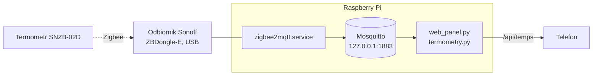

# Termometry Zigbee

Czujniki temperatury i wilgotności (Sonoff SNZB-02D) widoczne w panelu WWW w zakładce **Temperatury**.



## Dodanie kolejnego termometru

1. Otwórz http://192.168.8.18:8080 (panel Zigbee2MQTT) i włącz dołączanie urządzeń (**Permit join**). To samo z konsoli Pi: `mosquitto_pub -t zigbee2mqtt/bridge/request/permit_join -m '{"time":254}'`.
2. Przytrzymaj przycisk z tyłu termometru ok. 5 s, aż zacznie migać ikona sygnału. Po chwili urządzenie pojawi się na liście.
3. Zmień mu nazwę na nazwę pomieszczenia, np. `salon`. **Ta nazwa jest nazwą kafelka w panelu** (pierwsza litera zostanie zamieniona na wielką).
4. Wyłącz dołączanie urządzeń (samo wygasa po 254 s).

W kodzie niczego nie trzeba zmieniać — każde urządzenie Zigbee, które podaje temperaturę, pojawia się w zakładce samo, w kolejności alfabetycznej.

Usunięcie albo zmiana nazwy w panelu Zigbee2MQTT od razu usuwa stary kafelek.

## Zakładka Temperatury

- Kafelek na czujnik: temperatura, wilgotność, wiek odczytu („12 min temu”). Odświeżanie co 10 s.
- Czujnik wysyła odczyt po zmianie temperatury albo wilgotności (w praktyce co kilka minut, widać zmiany o 0,2 °C), najrzadziej co godzinę. Po 3 h ciszy (`STALE_S`) kafelek szarzeje i pokazuje „Brak odczytu – ostatni …” — bateria albo zasięg.
- Poziom baterii pojawia się dopiero, gdy spadnie do 20%.
- **Dotknięcie kafelka** otwiera pod spodem wykres temperatury z ostatnich 24 h (drugie dotknięcie go zamyka). Strzałka ‹ przechodzi do wcześniejszych dni (doba 00:00–24:00), › wraca, **Teraz** — od razu do ostatnich 24 h. Pod datą: nazwa czujnika i zakres min – max. Dotknięcie wykresu pokazuje godzinę, temperaturę i wilgotność. Przerwa w linii = ponad 2 h bez odczytu.
- Historia jest zbierana od 2026-10-13 w `data/termometry.db` (SQLite, poza repo), bez limitu czasu. Jest przypisana do **nazwy** czujnika — po zmianie nazwy wykres zaczyna się od nowa.

## Zainstalowane urządzenia

| Nazwa | Model | Adres | Od |
|---|---|---|---|
| `kuchnia` | Sonoff SNZB-02D | `0x08ddebfffef711fd` | 2026-10-13 |

## Instalacja na Pi (2026-10-13)

| Co | Gdzie | Uwagi |
|---|---|---|
| Odbiornik | Sonoff Zigbee 3.0 USB Dongle Plus V2 (ZBDongle-E), firmware 7.4.4 (EZSP 13) | `/dev/serial/by-id/usb-Itead_Sonoff_Zigbee_3.0_USB_Dongle_Plus_V2_…` |
| Mosquitto 1.5.7 | apt, `mosquitto.service` | tylko `127.0.0.1:1883` (`/etc/mosquitto/conf.d/local.conf`: `bind_address 127.0.0.1`) |
| Node.js 22.23.3 | `/opt/node` | patrz niżej |
| Zigbee2MQTT 2.14.2 | `/opt/zigbee2mqtt`, `zigbee2mqtt.service` | kanał 20, panel na porcie 8080 **bez hasła** |

Kopie: [`deploy/systemd/zigbee2mqtt.service`](../deploy/systemd/zigbee2mqtt.service), [`deploy/zigbee2mqtt/configuration.yaml`](../deploy/zigbee2mqtt/configuration.yaml) (bez kluczy sieci).

**Kopia zapasowa sieci:** `/opt/zigbee2mqtt/data/` (`configuration.yaml` z kluczem sieci, `database.db`, `coordinator_backup.json`). Bez niej po awarii karty SD wszystkie czujniki trzeba parować od nowa. Katalogu nie ma w repo — zawiera klucz sieci.

### Node.js na Raspbianie 10

Oficjalny Node 22 dla armv7l wymaga `GLIBCXX_3.4.26`, a buster ma 3.4.25. Systemowej biblioteki nie ruszałem — nowsza `libstdc++.so.6` (GCC 9.4, paczka `libstdc++6_9.4.0-1ubuntu1~16.04_armhf.deb` z PPA `ubuntu-toolchain-r/test`) leży w `/opt/node/compat`, a `/opt/node/bin/node` to skrypt, który ustawia `LD_LIBRARY_PATH` i uruchamia prawdziwy `/opt/node/bin/node.bin`. Wersja z bullseye nie nadaje się (wymaga glibc 2.29).

Mosquitto pochodzi z `legacy.raspbian.org` (stare repozytorium bustera zwraca 404); `/etc/apt/sources.list` zostało bez zmian — instalacja z tymczasową listą źródeł.

### Odtworzenie Zigbee2MQTT

```bash
export PATH=/opt/node/bin:$PATH
sudo npm install -g pnpm@11.26.0
sudo mkdir -p /opt/zigbee2mqtt && sudo chown pi:pi /opt/zigbee2mqtt
git clone --depth 1 --branch 2.14.2 https://github.com/Koenkk/zigbee2mqtt.git /opt/zigbee2mqtt
cd /opt/zigbee2mqtt && pnpm install --frozen-lockfile && pnpm run build
cp ~/dzarwisV2/deploy/zigbee2mqtt/configuration.yaml data/      # albo kopia zapasowa data/
sudo cp ~/dzarwisV2/deploy/systemd/zigbee2mqtt.service /etc/systemd/system/
sudo systemctl daemon-reload && sudo systemctl enable --now zigbee2mqtt.service
```

### Diagnostyka

```bash
systemctl status zigbee2mqtt mosquitto
journalctl -u zigbee2mqtt -n 50
mosquitto_sub -v -t 'zigbee2mqtt/+'          # ostatnie odczyty wszystkich urządzeń
curl -s http://localhost/api/temps
```

## Jak to działa w panelu

`scripts/termometry.py` uruchamia `mosquitto_sub -v -t 'zigbee2mqtt/+'` i czyta wiersze „temat treść” (bez dodatkowych bibliotek Pythona). Każda treść z liczbowym polem `temperature` trafia do słownika odczytów; pusta treść usuwa czujnik. Po zerwaniu połączenia z brokerem ponawia co 5 s. `GET /api/temps` zwraca:

```json
{"sensors": [{"id": "kuchnia", "label": "Kuchnia", "temperature": 21.4, "humidity": 55.4,
              "battery": 100, "linkquality": 92, "ts": 1791878000, "stale": false}]}
```

`ts` to czas ostatniego kontaktu z czujnikiem (`last_seen` z Zigbee2MQTT), `humidity`/`battery`/`linkquality` mogą być `null`.

Każdy odczyt trafia też do `data/termometry.db` (tabela `readings`: `name`, `ts`, `temperature`, `humidity`). `GET /api/temps/history?id=kuchnia` zwraca ostatnie 24 h, a z `&date=RRRR-MM-DD` (wcześniejszą niż dziś) — dobę kalendarzową:

```json
{"id": "kuchnia", "label": "Kuchnia", "date": null, "today": "2026-10-13", "first_date": "2026-10-13",
 "start": 1791791700, "end": 1791878101, "min": 21.2, "max": 21.4,
 "points": [[1791878116, 21.4, 54.4]]}
```

`points` to `[ts, temperatura, wilgotność]`, `first_date` — pierwszy dzień z danymi (blokuje strzałkę ‹).
